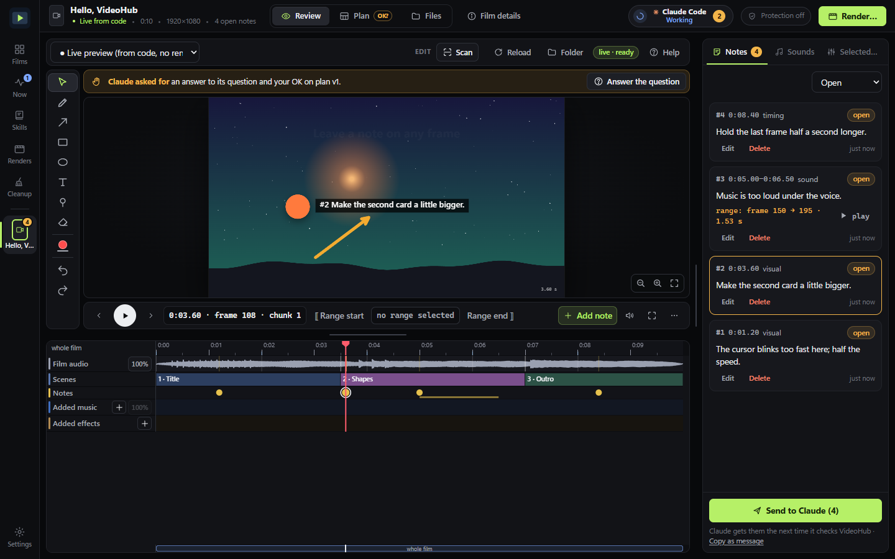
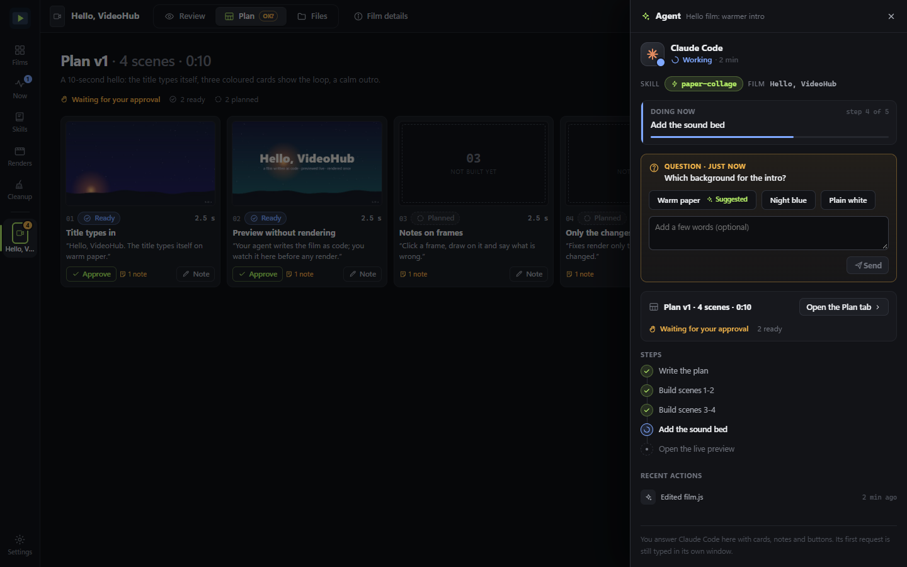
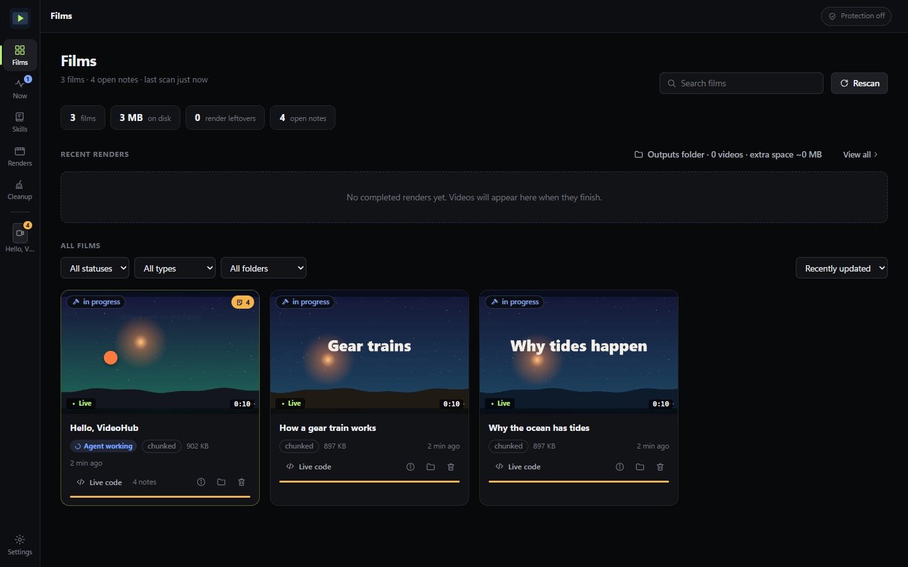
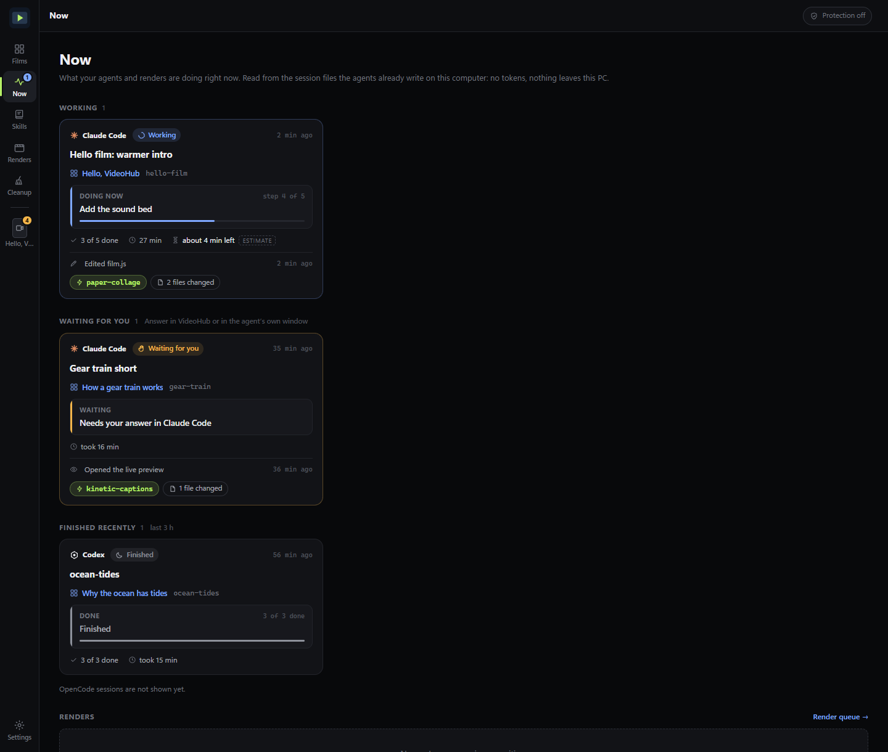
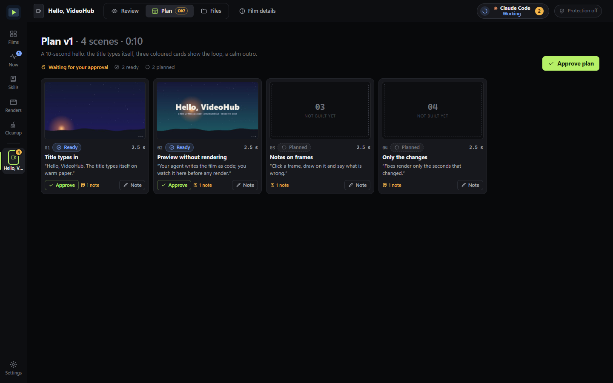
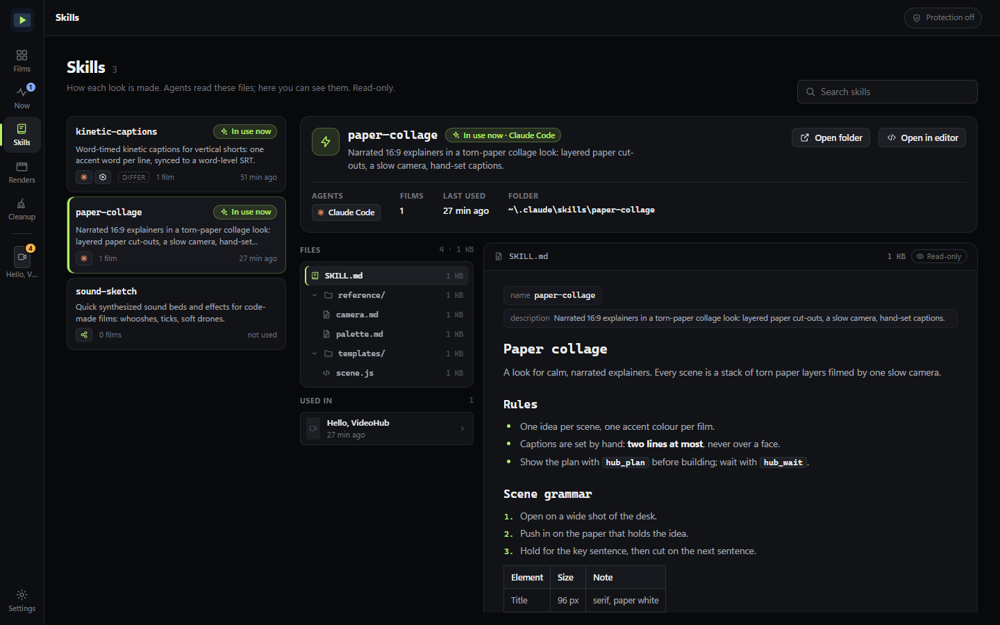
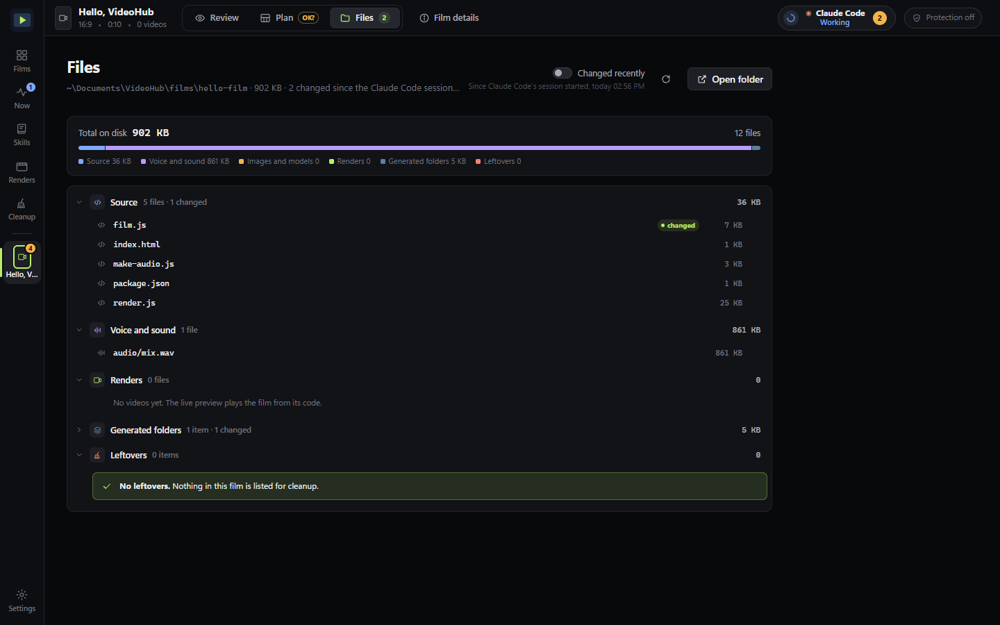

# VideoHub

**A local studio for videos that your coding agent writes as code: plan, preview, notes and renders in one window.**
Ask Claude Code, Codex or OpenCode for a video. The agent builds the film as a web page that draws every frame in code. VideoHub shows you its plan as scene cards, plays the film straight from its code (no render), lets you draw on frames and leave notes, and hands everything back to the agent with a click: no copying text between windows. When you are happy, the render queue makes the video while the computer stays usable, and later fixes re-render only the seconds that changed.

> **Windows 10/11, Linux and macOS; Claude Code, Codex or OpenCode. Linux and macOS are new, not yet tested on real machines.** See [platform support](docs/PLATFORMS.md) for feature limits and the remaining hardware checks.



## How it works
1. **Ask** your agent for a video in its own window (the first request is always typed there).
2. **Plan (only if you ask for one).** Say "show me the plan first" and the agent writes it as scene cards (`hub_plan`) on the film's **Plan** tab, where you approve it or leave a note on a scene. Otherwise it goes straight to building.
3. **Build and preview.** The agent builds the film and opens it in the **live preview** (`hub_live`). It plays from its code, frame-accurate, with its sound; when the code changes, the preview reloads itself.
4. **Notes.** Click or draw on any frame, type what is wrong and press **Send to agent**. Questions the agent asks (`hub_ask`) show up as cards you answer with a click.
5. **The agent waits for you.** Instead of ending its turn, the agent calls `hub_wait`, which returns the moment you send notes, answer a question or approve something. It fixes the code, marks the notes fixed and waits again; the preview updates in place.
6. **Render** only when you ask: one render at a time, with CPU/RAM protection. Later renders redo only the chunks your notes touched.

If no agent is waiting, **Send to agent** keeps your notes for its next `hub_wait`, and **Copy as message** still gives you a short text to paste into its chat.

## One window
The rail on the left holds every page; a film opens as tabs.

- **Films** — every film in your watched folders: a live cover drawn from the code, status, notes, disk use, and a mark when an agent is working on it.
- **A film: Review, Plan, Files** — *Review* is the player with the notes beside it: frame steps, ranges, a timeline with narration, scenes and sound stems, drawing tools, and **Check fixes**, a tour of the notes your agent marked fixed with before and after. *Plan* shows the scene cards with their state (planned, ready to watch, approved); approve a scene or the whole plan, or leave a note on one scene. *Files* groups the film folder into source, voice and sound, images and models, renders, big generated folders and leftovers, with sizes, a "changed recently" filter and the film's tidy-up. *Film details* keeps versions and the note history.
- **Now** — what is running right now: agent sessions that are working, waiting for you or finished recently (title, film, current step and steps done, time spent, an estimate when there is enough to go on, last action, skills used), and the render queue with its real remaining time.
- **Skills** — the skills in your agents' skill folders (Claude Code, Codex, OpenCode and the shared `~/.agents/skills`): which agents have each one, its files, `SKILL.md` rendered, and the films that used it. Read-only.
- **Renders** — the queue and recent renders: progress, ETA, Slow down / Normal speed / Stop, the render dialog (size, fps, workers, encoder) and a copy to any folder.
- **Cleanup** — first the **films with leftovers**: every film with something to free, most space first, with a tick box each (films marked approved / published / done / archived, and films that look finished — a final video and no change for 7 days — are badged and ticked) and one combined review before anything moves; a film is marked approved once it was tidied. Then what can safely go in every film (old chunks, silent copies, browser profiles, check frames, old versions) and why. **Finish film…** (also on a film's Files tab and Film details) shows what stays, what goes to the Recycle Bin / Trash, what goes to the archive and the optional items, each with its size and reason, before anything moves; it keeps the film's code, inputs, voice-over, final mix and newest video, and counts only space that really comes back (a file with another hard link frees nothing). **Render leftovers** are also looked for by VideoHub itself: after the first scan, about 45 seconds after each finished render and every 6 hours (never while a render runs or waits, or a cleanup runs), it counts silent intermediate renders, the `film_final.mp4` copies a render script made of a version, replaced chunks, browser profiles and temporary files, and the chunks of films not rendered for 7 days. When they would free 500 MB or more, a strip at the top of every page asks: *Render leftovers: 12.4 GB in 9 projects — Review · Clean now · Later*. **Review** opens Cleanup with exactly those items selected, **Clean now** moves exactly them to the Recycle Bin / Trash, **Later** keeps that set quiet for 24 hours (more leftovers may ask again sooner); with no window open, a desktop notification says so once. Sizes are the space that really comes back once the Recycle Bin / Trash is emptied. Settings → Render leftovers turns the question off and sets the days for old chunks. Always to Trash / Recycle Bin or the archive, never deleted outright, always with your approval.
- **Settings** — watched folders, workspace, render protection, encoders, agent name, the agent-activity switch and the optional parts found on this computer.

The **agent drawer** opens from the agent pill in a film's top bar: the agent's status and current step, its open questions with clickable answers, the plan and its approval, and what it did last.



### Seeing what the agent does, without spending tokens
The Now page, the agent pill and the Skills page's "used in" lists come from the session files the agents already write on your computer (Claude Code: `~/.claude/projects`; Codex: `~/.codex/sessions`). VideoHub reads only files changed in the last few hours and only the new part of each file, and keeps only derived facts: agent, session title, folder, film, state, plan steps, times, a plain-English last action, skill names and how many files changed. Prompt text, answers and file contents are never stored or shown, nothing is sent anywhere, and the agents are never asked to report, so it costs no tokens. **Settings → Show agent activity** turns it off; then VideoHub does not touch the agents' folders at all. OpenCode sessions are not read yet (everything else works with OpenCode).

| | |
|---|---|
|  |  |
|  |  |



### Render queue and protection
Built into the Node server, with no compiled helper:
- **One render at a time** on the computer (it also waits for renders started elsewhere), progress and ETA, a desktop notification when available, and every finished render hard-linked into one outputs folder (a folder per day, no extra disk space).
- **Partial re-render** — a film rendered in 2-second chunks re-renders only the chunks your notes touched, joins the film again and saves `film_vN.mp4`; **Watch only the changes** plays just those.
- **Sound** — mute/solo/levels per stem, remove the music, duck it under a range, add sounds from your library or disk; renders use the rebuilt mix.
- **CPU limits and priority** — Windows uses processor affinity; Linux uses `taskset` when installed. Renders run at low priority, with Full power / Balanced / Quiet presets and a temporary full-power window.
- **macOS protection** — niceness and background QoS (`taskpolicy`) when a render slows down. macOS has no supported CPU-core affinity API, so VideoHub hides the Render power and slow CPU sliders and explains the limit.
- **RAM slow mode** — when available RAM crosses a threshold, the newest render slows down; at critical RAM, every render slows down. A list shows other programs holding RAM (VideoHub never closes them). On Unix, restoring a numerically lower nice value can require privileges, so a slowed render may keep its lower priority until it ends; VideoHub never asks for elevated privileges.
- **Hardware encoders** — Windows: NVENC / AMF / QSV; Linux: NVENC / VAAPI / QSV; macOS: VideoToolbox; x264 is the processor fallback. A short encode probe decides what works with the installed ffmpeg. See [render speed](docs/RENDER-SPEED.md); Linux and macOS performance is unverified.

### Agent tools (MCP)
`hub_plan`, `hub_ask`, `hub_wait`, `hub_live`, `hub_notes`, `hub_note_update`, `hub_render`, `hub_job`, `hub_project`, `hub_workspace`, `hub_register_version`, `hub_cleanup`, `hub_finish`. The same tools work from a shell: `node <VideoHub>/server/cli.js <tool> "<json>"`. How long `hub_wait` may block in each agent is measured in [docs/AGENT-WAIT.md](docs/AGENT-WAIT.md).

## Requirements
All platforms need Node.js 22+, ffmpeg on PATH, a native Chrome/Chromium/Edge browser for headless rendering, and Claude Code, Codex or OpenCode for making and fixing films. No native modules or compiled render-protection helper are required.

| Platform | Install missing tools | Notes |
|---|---|---|
| Windows 10/11 | `winget install -e --id OpenJS.NodeJS.LTS`; `winget install -e --id Gyan.FFmpeg` | Edge or Chrome; setup retains the existing Windows paths |
| Linux desktop | Your distribution's Node 22+ package; `sudo apt install ffmpeg`, `sudo dnf install ffmpeg`, or `sudo pacman -S ffmpeg` | Install a native browser; Snap/Flatpak browser wrappers are unsupported. Optional `taskset`, `zenity`/`kdialog`, `notify-send` |
| macOS | With Homebrew: `brew install node ffmpeg`; `brew install --cask google-chrome`, or Chrome from its download page | Chrome / Edge / Chromium in `/Applications` or `~/Applications`; Apple Silicon and Intel code paths need hardware verification |

A graphical desktop session is needed for windows, folder dialogs, desktop notifications and file-manager actions. A compatible graphics encoder is optional.

## Install
Download the ZIP and unpack it, or clone the repository into a folder you want to keep. Open that folder in Claude Code, Codex or OpenCode and ask it to install VideoHub, or run the installer yourself. Setup asks about the workspace, discovered video folders, graphics encoding, agents, review rule, shortcut, login startup and example film. Re-runs keep existing answers, folders and settings.

### Windows
Double-click **SETUP.cmd**. It runs the shared Node installer directly. Preview the steps with `node scripts/install.mjs setup --dry-run`; `--yes` accepts recommended answers. Examples: `--workspace "D:/Videos/VideoHub"` and `--agents claude,codex,opencode`. The same answer flags shown below work on every platform.

The `.ps1` setup/update/uninstall files are compatibility forwarders and respect PowerShell's existing policy. If that policy blocks one, use the Node command or `.cmd` entry point; no policy change is needed.

Open VideoHub from its Desktop shortcut or **open.cmd**. The shortcut starts the installed Node.js executable directly; a console window may appear briefly. `open.cmd` and login startup may also show a short console window. The current launch path uses neither VBScript nor hidden PowerShell. Update migrates owned shortcut/startup entries and recycles the old `open.vbs` / `open.ps1` only when those references are safe; custom, unreadable or failed migrations retain the files and show a warning. Start a new session in your selected agent to load `hub_*` tools.

### Linux and macOS
Run `chmod +x setup.sh update.sh uninstall.sh open.sh`, then `./setup.sh`. Preview first with `./setup.sh --dry-run --agents opencode`. Setup prints missing-system-tool instructions instead of silently installing system packages.

Flags: `--yes`, `--workspace PATH`, `--agents claude,codex,opencode`, and `--watch-found`, `--gpu-encoder`, `--global-rule`, `--shortcut`, `--startup`, `--example` with `yes` or `no`. Launch with `./open.sh`. Linux also installs an application desktop entry and can add a Desktop copy.

On macOS the optional Desktop launcher is **VideoHub.command**, which briefly opens Terminal. There is no unsigned `.app` bundle. If macOS blocks the downloaded launcher, attempt to open it, then go to **System Settings → Privacy & Security → Open Anyway**, confirm, and open it again. You can also launch with `./open.sh` from the installed folder.

### Claude Code, Codex and OpenCode
Setup detects the installed agents. Select any of them with `--agents claude,codex,opencode` on every platform; legacy Windows `-Agents` spelling remains accepted. Each selected agent receives its own local MCP registration, the shared skill and the optional marked review rule. Restart the selected agent after setup.

| Agent | MCP entry | Skill | Review rule |
|---|---|---|---|
| Claude Code | `claude mcp` (user scope) | `~/.claude/skills/videohub` | `~/.claude/CLAUDE.md` |
| Codex | `[mcp_servers.videohub]` in `~/.codex/config.toml` (or `$CODEX_HOME`), with `tool_timeout_sec = 600` so `hub_wait` and `hub_job` fit in one call | `~/.codex/skills/videohub` | `~/.codex/AGENTS.md` |
| OpenCode | `opencode mcp add --global` (`~/.config/opencode/opencode.json`) | `~/.config/opencode/skills/videohub` | `~/.config/opencode/AGENTS.md` |

OpenCode's rules live under `$XDG_CONFIG_HOME` if set. When that file exists OpenCode reads it instead of Claude's global compatibility rules; setup prints this consequence. Setup only touches VideoHub's own entries and never copies unrelated personal rules between agents. Settings → Agent name controls the review button label.

### Desktop window (optional)
VideoHub normally opens in a browser app window. If you prefer a window of its own, the `desktop/` folder holds a small Electron shell: it reuses the running hub or starts it (the same way `open.cmd` / `open.sh` do), opens it in one window, remembers its size and place, and sends web links to your default browser. Closing the window does not stop the hub, since renders may be running; the hub stops by itself when nothing uses it.

```
cd desktop
npm install
npm start
```

`npm install` there downloads Electron (about 100 MB, on the first `npm start` if not before); nothing else in VideoHub downloads or needs it. No packaged installer is shipped: an unsigned packaged app would trigger Windows SmartScreen (and macOS Gatekeeper) warnings, so the shell runs from source with the Electron package from npm.

## Your first film
1. If setup added the example film, its card is on the Films page. Otherwise the page shows **Welcome to
   VideoHub** with your workspace and films folder (`<workspace>/films`): click **Add the example film**.
2. Click its card: it opens in the **live preview**. Press Space, step with ← →, click on the video to leave a note.
3. Press **Render…** → *Full film*: the queue renders 5 two-second chunks and saves `hello-film_v1.mp4` with sound.
4. Leave a note on a frame, change `film.js` (for example a colour), then **Render…** → *Only the fixed parts*: only the
   touched chunks are rendered again → `hello-film_v2.mp4`, and **Watch only the changes** plays them.

What a film folder must contain for each feature: [docs/PROJECT-CONTRACT.md](docs/PROJECT-CONTRACT.md). New films start
from [templates/new-film](templates/new-film).

## Working with your agent
1. **Ask** for a video in your agent's window. It makes the film folder in your workspace and starts building.
2. **A plan, if you want one** — ask for the plan first and the agent puts it on the film's Plan tab (`hub_plan`); approve it or leave a note on a scene, and the agent gets that through `hub_wait`.
3. **Preview** — when the film plays, the agent calls `hub_live` and waits. Answer its questions in the agent drawer.
4. **Notes** — watch, leave notes, press **Send to agent**. The waiting agent gets them at once, fixes the code, marks the notes fixed and waits again; the preview updates itself. **Check fixes** walks you through what it changed.
5. **Render** — when you ask, the agent calls `hub_render`, or you press Render. Later fixes can render only the changed chunks.

Older agent sessions that do not know `hub_wait` still work: press **Copy as message** and paste it into the chat; the agent reads the notes with `hub_notes`. If MCP tools are not loaded, the same tools work through `node <VideoHub>/server/cli.js <tool> "<json>"`.

## Optional integrations
| Feature | Needs | Without it |
|---|---|---|
| Ready-made sound effects | a 3D studio engine with `engine/audio/synth.js` (`studioDir` in Settings) | your own sound folder and files from disk |
| Scene editor / 2D layers in the preview | the page includes the hooks from `engine-hooks/` | those editors are hidden |
| Snipp export status | Snipp writing `.renders\*.json` in a watched folder | not shown |
Settings → *Optional parts on this computer* shows what was found.

## Security
VideoHub is a local tool. The server listens on **127.0.0.1 only** and refuses requests with a foreign Host, cross-site
requests from other web pages and writes with a foreign Origin. Its render queue can run shell commands for your
projects, so **never expose port 7788** (no port forwarding, no tunnels, no `0.0.0.0` proxies). It only serves files
inside your watched folders, the archive and its own folders. The optional desktop window shows only the hub's own
address, with Electron's sandbox on and no Node access for the page; any other web link opens in your default browser.

### Windows launch and security warnings
Windows setup, update and uninstall use the shared Node lifecycle commands listed in the security guide. `SETUP.cmd` and `UPDATE.cmd` call Node directly. Normal launch uses `open.cmd` → Node → `scripts/install.mjs open`; new Desktop shortcuts and login startup also use the installed Node executable. None of these paths changes PowerShell's execution policy or adds a policy override. Windows integrations still use transparent commands and installed Windows/.NET libraries where needed: the picker loads WinForms, and Trash uses the installed Recycle Bin API. Nothing compiles inline C# or custom P/Invoke helpers.

See [Windows security guidance](docs/WINDOWS-SECURITY.md) for the current behavior, exact-alert evidence and upgrading an older distributed copy.

These changes simplify the launch and system-integration paths. They do not establish that a security alert is a false positive or guarantee that a vendor will accept every downloaded version. Record the security product, exact warning or detection ID, affected file and VideoHub version before deciding what needs review. `node scripts/windows-security.mjs` prints local source fingerprints and retired-helper presence without reading antivirus history or uploading anything; it is not an antivirus scan.

| Warning type | What to distinguish |
|---|---|
| Antivirus malware detection | A named threat/detection for a file needs investigation of that exact file and verdict. Keep the blocked item blocked during review. |
| SmartScreen / unknown publisher / reputation warning | Publisher identity and download reputation are separate from a named malware detection. The exact message identifies which check was involved. |
| Smart App Control block | This is an application-control trust decision. It is not interchangeable with an antivirus detection or a script-policy error. |
| PowerShell scripts disabled / unsigned-script error | This is a script-policy restriction. Use the direct Node lifecycle command instead of the optional `.ps1` compatibility entry; no policy setting needs to change. Other application-control restrictions still need the computer's approved deployment process. |

If an examined distributable still receives a malware detection, use that product vendor's official file-review process for the exact affected file. Review what the submission contains first; VideoHub does not upload files to scanners or vendors automatically. Disabling security protection, adding broad exclusions or bypassing download/script policies is not part of setup.


## Update
Download the new version and unpack it separately. Windows: double-click `UPDATE.cmd`, or run `node scripts/install.mjs update --target "C:/path/to/installed/VideoHub" --dry-run`, then repeat without `--dry-run`. Linux/macOS: from the new copy run `./update.sh --target /path/to/installed/VideoHub --dry-run`, then repeat without `--dry-run`.

The update backs up replaced code and keeps the workspace, settings, queue, films and notes. Use the existing launcher afterwards and restart your agent session so it loads the new skill and tools (`hub_plan`, `hub_ask`, `hub_wait`). The update copies the desktop shell's source; an Electron already installed in `desktop/node_modules` stays. Downloaded or shared copies do not change automatically: distribute this version and explicitly update each installed copy that needs it.

## Uninstall
Windows: from the installed folder run `node scripts/install.mjs uninstall --dry-run`, then repeat without `--dry-run` or use `UNINSTALL.cmd`. Linux/macOS: `./uninstall.sh --dry-run`, then `./uninstall.sh` from the installed folder.

Only integrations owned by this install are removed: MCP entry, skill, managed rule block, shortcut and login startup. Reversible removals use Trash / Recycle Bin. Films, notes, outputs, settings and the program folder remain (including an Electron download in `desktop/node_modules`, which you can delete with the program folder).

## Troubleshooting
- **macOS Trash permission** — Finder may ask for Automation permission the first time VideoHub moves a file to Trash. Allow it in System Settings → Privacy & Security → Automation for the requesting terminal/process. If denied, VideoHub refuses the operation and keeps the source; it never falls back to permanent deletion.
- **macOS launcher blocked** — use Privacy & Security → Open Anyway after the first blocked launch of `VideoHub.command`, or run `./open.sh`. No `.app` bundle is shipped.
- **macOS Render power is missing** — macOS has no supported CPU-core limit. Low priority, background QoS and RAM protection remain available; the Renders page explains the limitation.
- **Linux folder picker is unavailable** — install `zenity`/`kdialog`, or enter the path in the text field.
- **Linux CPU limit unavailable** — install `taskset` (util-linux). Low priority and RAM watching still work. Raising Unix priority after slowing down may require privileges; a fresh render starts with its configured priority.
- **Linux browser not found** — use a native browser package. Snap/Flatpak browser wrappers cannot reliably be driven by Puppeteer; `VIDEOHUB_BROWSER` can select a native executable.
- **Linux Trash unavailable** — VideoHub tries `gio`, `trash-put`, then the freedesktop Trash format; it refuses an unsafe or unwritable destination and leaves the item in place.
- **The page is blank** — open it in a browser and look at the console; a missing Node 22 or a broken update are the
  usual causes. Restart with the Desktop shortcut.
- **Your agent does not see `hub_*` tools** — start a new session; `claude mcp list`, `codex mcp list` or `opencode mcp list` should show `videohub`. Re-run the installer for that agent if needed.
- **The agent ends its turn instead of waiting** — it runs with an old skill: start a new session after setup or update. Notes you sent stay in the inbox until its next `hub_wait`; **Copy as message** works meanwhile.
- **Codex stops `hub_wait` after about a minute** — its entry lacks `tool_timeout_sec`; re-run setup with `--agents codex` (VideoHub sets 600 s; `hub_wait` returns safely before the limit either way and the agent calls it again).
- **The Now page is empty** — Settings → Show agent activity must be on, and only Claude Code and Codex sessions changed in the last few hours are shown; OpenCode sessions are not read yet.
- **The desktop window says Node.js was not found** — it starts the hub with the installed Node.js from `PATH`; install Node 22+ or start VideoHub once with `open.cmd` / `./open.sh`, then open the window again.
- **"This folder is not a project VideoHub knows"** — put the film inside a watched folder or add its parent folder
  in Settings → Watched folders.
- **"The live preview could not open"** — the page lacks `window.renderOut(t)` / `window.READY`; see
  PROJECT-CONTRACT.md. The message says what is missing.
- **Partial renders refused** — the render script is not chunked (family A) or the film length is unknown:
  `hub_project({set:{render:{env:{DUR:"…"}}}})`.
- **Renders fail at once** — ffmpeg or a native Chrome/Chromium/Edge browser missing (Settings → Tools), or `puppeteer-core` missing for a
  film's render script (VideoHub ships one; run `npm install` in VideoHub's folder).
- **Port 7788 is taken** — set `"port"` in `data\config.json`.
- **A warning names `RenderGuard.exe` / `VideoHubAgent.exe`** — these names belonged to the retired compiled render-protection helper. Current source neither builds nor ships it. Update retires a recognized helper belonging to the target install without launching that executable. Classify the exact warning using the distinctions above; its filename alone does not establish a false positive.
- **Coming from the previous version or an older (Turkish) build** — see [docs/MIGRATING.md](docs/MIGRATING.md).

## Development
`npm test` runs the suites (it never needs Electron); see [CLAUDE.md](CLAUDE.md) and [docs/ARCHITECTURE.md](docs/ARCHITECTURE.md).

## License
[MIT](LICENSE) © 2026 VideoHub contributors.
